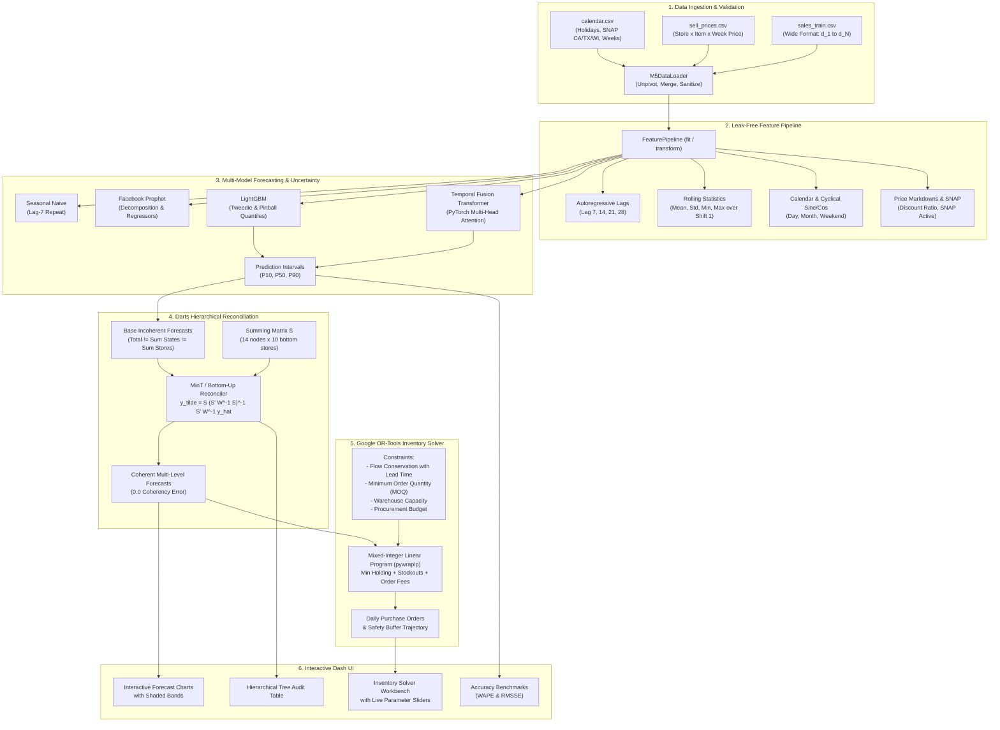

# 🏗️ System Architecture & Engineering Design

## Nationwide Demand Forecasting and Inventory Optimization

This document details the production architecture, data flow, mathematical modeling foundations, and operations research formulations for the Nationwide Demand Forecasting and Inventory Optimization platform.

---

## 1. High-Level Architecture Diagram

---

## 2. Mathematical Formulations

### 2.1 M5 Evaluation Metrics

#### Root Mean Squared Scaled Error (RMSSE)
RMSSE is the official metric of the M5 competition. It scales forecast MSE by the in-sample naive 1-step random-walk MSE, making errors directly comparable across slow-moving and fast-moving SKUs:

$$\text{RMSSE} = \sqrt{\frac{\frac{1}{h} \sum_{t=n+1}^{n+h} (y_t - \hat{y}_t)^2}{\frac{1}{n-1} \sum_{t=2}^n (y_t - y_{t-1})^2}}$$

Where:
- $h = 28$ is the forecast horizon.
- $n$ is the historical training sample size.
- $y_t$ is actual demand, $\hat{y}_t$ is forecast demand.

#### Weighted Absolute Percentage Error (WAPE)
WAPE resolves the division-by-zero vulnerability of standard MAPE on zero-demand days:

$$\text{WAPE} = \frac{\sum_{t=1}^h |y_t - \hat{y}_t|}{\sum_{t=1}^h y_t}$$

---

### 2.2 Hierarchical Reconciliation (MinT)

Let the full time series vector of $m = 14$ nodes be partitioned into $m_a = 4$ aggregate nodes (Total, CA, TX, WI) and $m_b = 10$ bottom nodes (CA_1..CA_4, TX_1..TX_3, WI_1..WI_3):

$$y_t = S b_t$$

Where $S \in \mathbb{R}^{m \times m_b}$ is the hierarchical summing matrix:

$$S = \begin{bmatrix} \mathbf{1}_{1 \times 10} \\ S_{\text{state}} \\ I_{10 \times 10} \end{bmatrix}$$

Base forecasts $\hat{y}_t$ generated independently at each level are incoherent ($S \hat{b}_t \ne \hat{y}_t$). The Minimum Trace (MinT) linear reconciler finds the optimal unbiased mapping:

$$\tilde{y}_t = S P \hat{y}_t$$

Where:

$$P = (S^T W^{-1} S)^{-1} S^T W^{-1}$$

$W$ is the covariance matrix of base forecast residuals $\hat{e}_t = y_t - \hat{y}_t$, regularized with Ledoit-Wolf shrinkage to ensure positive-definiteness:

$$W_{\text{shrink}} = (1 - \lambda) \hat{\Sigma} + \lambda \operatorname{diag}(\hat{\Sigma})$$

---

### 2.3 Operations Research MILP Formulation (Google OR-Tools)

The inventory replenishment policy is modeled as a deterministic multi-period, multi-item Mixed Integer Linear Program (MILP):

#### Decision Variables:
- $O_{i,t} \ge 0$: Continuous replenishment order quantity for SKU $i$ placed at start of day $t$.
- $y_{i,t} \in \{0, 1\}$: Binary order setup indicator (triggers fixed ordering/transportation cost).
- $I_{i,t} \ge 0$: On-hand ending inventory of SKU $i$ at day $t$.
- $S_{i,t} \ge 0$: Unmet demand (stockout quantity) of SKU $i$ at day $t$.

#### Objective Function:
$$\min \sum_{t=1}^T \sum_{i \in \mathcal{I}} \left[ c_{h,i} \cdot I_{i,t} + c_{s,i} \cdot S_{i,t} + c_{o,i} \cdot O_{i,t} + c_{f,i} \cdot y_{i,t} \right]$$

Where:
- $c_{h,i}$: Daily holding cost per unit.
- $c_{s,i}$: Stockout penalty cost per unit.
- $c_{o,i}$: Unit purchase price.
- $c_{f,i}$: Fixed purchase order / truck delivery fee.

#### Constraints:
1. **Inventory Flow Conservation with Lead Time $L_i$:**
   $$I_{i,t} - S_{i,t} = I_{i,t-1} - S_{i,t-1} + O_{i, t - L_i} - \hat{D}_{i,t} \quad \forall i, \forall t$$

2. **Minimum Order Quantity (MOQ) and Order Gating:**
   $$\text{MOQ}_i \cdot y_{i,t} \le O_{i,t} \le M \cdot y_{i,t} \quad \forall i, \forall t$$

3. **Warehouse Volume Capacity:**
   $$\sum_{i \in \mathcal{I}} v_i \cdot I_{i,t} \le C_W \quad \forall t$$

4. **Working Capital / Daily Budget:**
   $$\sum_{i \in \mathcal{I}} c_{o,i} \cdot O_{i,t} \le B_t \quad \forall t$$
